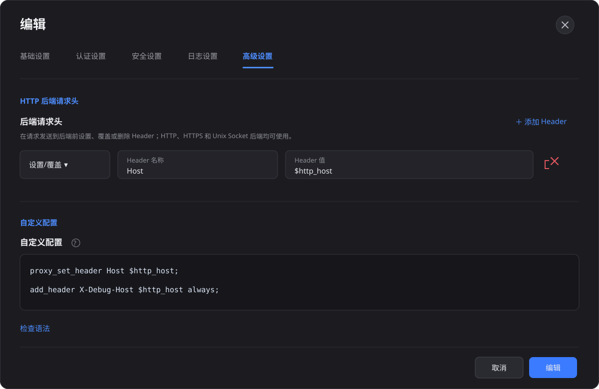

# fnos-oss 开发者文档

> 轻量对象存储（fnos-oss）——可安装到飞牛 fnOS 的单机 S3 兼容对象存储。
> 仓库：https://github.com/Contribuv/fnos-oss

后端是单个 Go 二进制 `ossd`，管理端 SPA 内嵌其中；S3 API 使用独立 TCP 端口，供 rclone、AWS CLI、boto3 等客户端连接。没有外部数据库、缓存或前端构建链，打包后离线可运行。

## 1. 运行模型

一个进程同时提供两个入口：

| 入口 | 监听方式 | 用途 |
| --- | --- | --- |
| S3 API | TCP，默认 `0.0.0.0:9100` | S3 协议，path-style 寻址 |
| 管理端 | Unix Socket（`app.sock`），由飞牛统一网关转发到 `/app/fnos-oss` | JSON API + 内嵌 SPA |
| 管理端（开发） | `--admin-addr 127.0.0.1:19101` | 仅用于本地调试，Windows 不支持 Unix Socket |

管理端依赖网关注入的 `X-Trim-Username`、`X-Trim-Userid`、`X-Trim-Isadmin` 头判断身份；直接访问 Socket 且没有这些头会被拒绝。`OSS_DEV=1` 时 loopback 请求被视为开发管理员。

## 2. 目录结构

```text
cmd/ossd/            服务入口：加载配置、启动 S3 与管理端、优雅退出
internal/config/     oss.json 加载与环境变量覆盖
internal/store/      bbolt 元数据 + 文件对象存储
internal/s3/         S3 协议：SigV4、预签名、aws-chunked、分段上传、CORS
internal/admin/      管理 API、活动日志、上传/下载/分享
internal/webui/      内嵌管理端 SPA（无构建链、无 CDN）
internal/version/    版本号，构建时通过 -ldflags 注入
tools/genicon/       应用图标生成器（纯 Go，无外部依赖）
tools/fixfpk/        修正 fpk 内文件权限
pack/                fnOS 打包目录：manifest、wizard、cmd、图标
build.ps1            Windows：交叉编译 + fnpack 打包
build.sh             Linux / macOS：同上
```

## 3. 本地开发

```bash
OSS_DEV=1 go run ./cmd/ossd \
  --config ./oss.json \
  --admin-addr 127.0.0.1:19101
```

Windows PowerShell：

```powershell
$env:OSS_DEV = "1"
$env:OSS_PORT = "19100"
$env:OSS_DATA_DIR = "$env:TEMP\fnos-oss\data"
go run ./cmd/ossd --config ./oss.json --admin-addr 127.0.0.1:19101
```

打开 `http://127.0.0.1:19101/app/fnos-oss/`（必须带 `/app/fnos-oss/`，与前端 `<base>` 一致）。

首次启动会自动创建一条默认访问密钥，访问密钥页面可以查看 Secret。

密钥的权限范围：

- `buckets` 为空（默认）表示可访问全部存储桶，与旧版本行为一致；
- 指定 `buckets` 后，该密钥只能读写这些桶，`ListBuckets` 也只返回这些桶；
- `readOnly` 为真时只允许 GET/HEAD，上传、删除、分段上传和修改桶都会被拒绝；
- 受限密钥不能创建、删除或修改桶策略，只能操作桶内对象（`DeleteObjects` 除外）。

环境变量：

| 变量 | 作用 | 默认 |
| --- | --- | --- |
| `OSS_PORT` | S3 TCP 端口 | `9100` |
| `OSS_SOCKET` | 网关 Unix Socket 路径 | 空 |
| `OSS_DATA_DIR` | 数据目录 | `./data` |
| `OSS_GATEWAY_PREFIX` | 管理端前缀 | `/app/fnos-oss` |
| `OSS_REGION` | S3 Region | `us-east-1` |
| `OSS_LOG_LEVEL` | `debug` / `info` / `warn` / `error` | `info` |
| `OSS_ADMIN_ADDR` | 管理端额外 TCP 监听（开发） | 空 |
| `OSS_DEV` | `1` 时 loopback 视为管理员 | 关 |

## 4. 配置文件 oss.json

```json
{
  "listen_host": "0.0.0.0",
  "port": 9100,
  "socket_path": "/vol1/@appdata/fnos-oss/app.sock",
  "gateway_prefix": "/app/fnos-oss",
  "data_dir": "/vol1/@appdata/fnos-oss/data",
  "region": "us-east-1",
  "public_endpoint": "https://s3.example.com",
  "log_level": "info",
  "max_upload_size": 0
}
```

文件不存在时使用默认值；环境变量优先于文件。`linux` 上才会启用 Unix Socket，Windows 会跳过并打印警告。

## 5. 存储布局

```text
data/
  meta.db       bbolt：桶、对象索引、密钥、设置
  objects/      内部模式的对象内容，按对象键 SHA-256 分片存放
  uploads/      分段上传会话
  tmp/          上传临时文件
```

写入流程：先落临时文件，成功后移动到 `objects/`，所以中断的上传不会留下半截对象。备份时必须先停止服务，再整体复制目录。

### 两种桶存储模式

| 模式 | 触发条件 | 对象位置 | 列表来源 |
| --- | --- | --- | --- |
| 内部（默认） | `Bucket.RootPath` 为空 | `data/objects/<桶>/<哈希分片>` | `meta.db` 索引 |
| 文件夹绑定 | 建桶时传入 `rootPath` | `<RootPath>/<对象键>`，真实文件 | 直接扫描目录 |

文件夹绑定模式由 `internal/store/root.go` 实现：

- 对象键按 `/` 分段校验，拒绝空段、`.`、`..`、以 `/` 结尾的键和绝对路径，不跟随符号链接。
- 文件名冲突（同一路径已是目录，或父路径是文件）返回 `ErrKeyConflict`，S3 层映射为 `409 KeyConflict`。
- 元数据仍存 `meta.db`，但只在大小与修改时间与磁盘一致时采用，否则按扩展名推断 Content-Type 并生成伪 ETag（`<size>-<mtime>`）。
- 删除对象后会向上清理空目录，但不会越过桶根目录；删除桶不会删除用户目录，且目录非空时拒绝删除。
- 同一目录不能绑定两个桶（`ErrRootPathInUse`）。
- 目录用量按目录扫描并缓存 1 分钟，`Stats()` 对两种模式求和。

授权链路：前端通过内嵌的 `@trimjs/web-app` ESM（`assets/trim-sdk.js`）调用 `pickSharedFile`，由飞牛宿主完成管理员共享授权；应用包在 `pack/config/resource` 中声明 `trim.file.sharedAccess`，并在 `pack/manifest` 设 `micro_app=true`。后端暂不调用 `trim.file.getSharedAccessibleFolders`，建桶时以“能否在目录内创建探针文件”作为可用性校验。

## 6. 管理端 API

所有 `/api/*`（除 `session`）都要求管理员身份。JSON 请求/响应，错误返回 `{ "error": "..." }`。

| 方法 | 路径 | 说明 |
| --- | --- | --- |
| GET | `/api/session` | 当前用户、版本、是否开发模式 |
| GET | `/api/overview` | 运行状态、容量、Endpoint、LAN 地址 |
| GET | `/api/activity?limit=` | 最近活动（默认最多 500 条） |
| GET | `/api/buckets` | 桶列表（含 `rootPath`） |
| POST | `/api/buckets` | 新建桶 `{ "name": "photos", "rootPath": "/vol1/share/photos" }`；`rootPath` 省略即为内部模式 |
| DELETE | `/api/buckets/{name}` | 删除空桶 |
| GET | `/api/buckets/{name}/objects?prefix=&delimiter=` | 前缀浏览 |
| GET | `/api/buckets/{name}/object?key=&download=1` | 读取或下载对象 |
| DELETE | `/api/buckets/{name}/object?key=` | 删除对象 |
| POST | `/api/buckets/{name}/upload?prefix=` | `multipart/form-data`：`key` + `file` |
| PATCH | `/api/buckets/{name}/policy` | `{ "policy": "private" \| "public-read" }` |
| POST | `/api/buckets/{name}/presign` | 为对象生成预签名 URL |
| GET | `/api/keys` | 密钥列表 |
| POST | `/api/keys` | 新建密钥 `{ "label": "...", "buckets": ["photos"], "readOnly": false }` |
| PATCH | `/api/keys/{access}` | 启用 / 停用；调整范围 `{ "enabled": true, "buckets": [...], "readOnly": false }` |
| DELETE | `/api/keys/{access}` | 删除密钥 |
| GET | `/api/settings` | 读取设置 |
| PATCH | `/api/settings` | 修改 CORS、上限制、公网地址 |
| POST | `/api/presign` | 通用预签名（GET / PUT） |

S3 端口没有管理接口，只有 S3 协议。

## 7. S3 支持范围

- SigV4：Header 签名、预签名 URL（GET / PUT）
- `aws-chunked` 流式上传与分块验签
- 桶与对象 CRUD、ListObjects V1 / V2、prefix + delimiter 浏览
- Range 下载、CopyObject、DeleteObjects、CORS
- 分段上传：Create / UploadPart / Complete / Abort / ListParts / ListUploads
- 桶策略：`private`（默认）与 `public-read`（匿名可 GET/HEAD 对象）

不支持：版本控制、生命周期、对象锁、静态网站托管、Bucket Notification、S3 Select、多租户 IAM/ACL、跨节点复制与纠删码。

匿名访问判定在 `internal/s3/handler.go`：桶为 `public-read` 且方法为 GET/HEAD 且带对象键时跳过鉴权。

## 8. 构建与打包

Windows：

```powershell
.\build.ps1 -Fnpack C:\path\to\fnpack.exe
.\build.ps1 -Fnpack ... -Arch amd64     # 只构建 x86
.\build.ps1 -Fnpack ... -SkipFpk        # 只编译不打包
```

Linux / macOS：

```bash
FNPACK=/usr/local/bin/fnpack ./build.sh
ARCHS="amd64:x86" ./build.sh
```

产物在 `dist/`，文件名里的版本取自 `internal/version/version.go`：

- `fnos-oss_<版本>_x86.fpk`
- `fnos-oss_<版本>_arm.fpk`

`pack/manifest` 的 `version` 必须与之一致；两个构建脚本都会先校验，不一致直接失败，避免打出“文件名是 1.0.1、应用中心仍显示 1.0.0”的包。

Windows 没有 POSIX 权限位，`fnpack` 会把包内文件打成 `0666`；两个脚本打包后都会运行 `tools/fixfpk`，把 `cmd/*` 与 `app/fnososs` 修正为 `0755`、其余修正为 `0644`，所以 Windows 构建的包可以直接安装。

图标由 `go run ./tools/genicon` 生成到 `pack/ICON.PNG`、`pack/ICON_256.PNG` 与 `pack/app/ui/images/`，几何绘制全部在 Go 里完成，离线可重建。

## 9. 前端约定

- SPA 位于 `internal/webui/assets/`：`index.html`、`app.js`、`app.css`、`favicon.svg`。
- 没有构建步骤，也没有 CDN；所有图标是内联 SVG。
- 修改 `app.js` 或 `app.css` 后必须把 `index.html` 里的 `?v=` 递增，否则浏览器会继续使用缓存的旧文件（HTML 是 `no-cache`，静态资源是 `max-age=3600`）。
- 主题通过 CSS 变量实现，跟随飞牛桌面或系统偏好；手动选择写入 `localStorage`。
- 响应式断点：`1120px` 调整网格，`900px` 切换为抽屉式导航（汉堡按钮 + 遮罩），`620px` 单列布局。
- 首次渲染前会从父窗口读取 Semi 主题变量，避免闪烁。

## 10. 测试

```bash
go test ./...
```

- `internal/s3`：签名、预签名、分块、分段上传
- `internal/store`：元数据与对象读写
- `internal/admin`：API 行为与鉴权
- `tools/fixfpk`：权限修正

前端没有自动化测试，改动后至少验证：桌面与 ≤900px 宽度下的导航、文档弹窗、上传/下载与分享链接。

## 11. 发布检查清单

1. 更新 `internal/version/version.go` 或构建参数中的版本号。
2. 更新 `pack/manifest` 的 `version` 与 `changelog`。
3. 确认 `maintainer` / `maintainer_url`、`distributor` / `distributor_url` 正确。
4. 递增 `index.html` 里的资源版本 `?v=`。
5. 运行 `go test ./...`，再执行 `build.ps1` / `build.sh`。
6. 安装 fpk，验证安装向导、端口修改、重启与卸载。

`appname` 与 `desktop_applaunchname` 不要修改：它们决定安装记录、升级路径与数据目录关联。

## 12. 常见问题

- **端口被占用**：进程启动失败，换端口或释放占用。
- **管理端 403 / 提示从飞牛桌面进入**：缺少网关注入的登录态；本地开发请设置 `OSS_DEV=1`。
- **签名错误**：确认客户端使用 SigV4、path-style、正确的 Region 与系统时间。
- **修改端口后客户端连不上**：客户端、反向代理和防火墙都需要同步更新。
- **分享链接失效**：对象已删除，或签名所用密钥被停用。

## 13. 私有桶与预签名 URL 网页对接

桶策略为 `private` 时，裸链接返回 `403 AccessDenied`，网页必须使用后端签发的临时签名 URL。签名是本地 HMAC 计算，不需要额外请求 NAS。

### 13.1 生成链接

统一参数：

| 项 | 值 |
| --- | --- |
| endpoint | 浏览器实际访问的地址，必须含端口，例如 `https://s3.example.com:7755` |
| region | 与服务端设置一致，默认 `us-east-1` |
| 寻址方式 | 必须 path-style |
| 有效期 | 1 ~ 604800 秒，页面展示建议 300 ~ 900 秒 |

Node.js：

```js
import { S3Client, GetObjectCommand } from "@aws-sdk/client-s3";
import { getSignedUrl } from "@aws-sdk/s3-request-presigner";

const s3 = new S3Client({
  region: "us-east-1",
  endpoint: "https://s3.example.com:7755",
  forcePathStyle: true,
  credentials: { accessKeyId: AK, secretAccessKey: SK },
});

const url = await getSignedUrl(
  s3,
  new GetObjectCommand({ Bucket: "demo-bucket", Key: key }),
  { expiresIn: 600 }
);
```

Python：

```python
import boto3
from botocore.config import Config

s3 = boto3.client(
    "s3",
    endpoint_url="https://s3.example.com:7755",
    aws_access_key_id=AK,
    aws_secret_access_key=SK,
    region_name="us-east-1",
    config=Config(signature_version="s3v4", s3={"addressing_style": "path"}),
)
url = s3.generate_presigned_url(
    "get_object", Params={"Bucket": "demo-bucket", "Key": key}, ExpiresIn=600
)
```

Go：

```go
client := s3.NewFromConfig(cfg, func(o *s3.Options) {
    o.BaseEndpoint = aws.String("https://s3.example.com:7755")
    o.UsePathStyle = true
})
req, _ := s3.NewPresignClient(client).PresignGetObject(ctx,
    &s3.GetObjectInput{Bucket: aws.String("demo-bucket"), Key: aws.String(key)},
    s3.WithPresignExpires(10*time.Minute),
)
```

PHP：

```php
$s3 = new Aws\S3\S3Client([
    'version' => 'latest',
    'region' => 'us-east-1',
    'endpoint' => 'https://s3.example.com:7755',
    'use_path_style_endpoint' => true,
    'credentials' => ['key' => AK, 'secret' => SK],
]);
$cmd = $s3->getCommand('GetObject', ['Bucket' => 'demo-bucket', 'Key' => $key]);
$url = (string) $s3->createPresignedRequest($cmd, '+10 minutes')->getUri();
```

### 13.2 前端使用

```js
const { url } = await fetch("/api/file-url?key=" + encodeURIComponent(key))
  .then((r) => r.json());
img.src = url;
```

- 链接过期或加载失败时重新请求业务后端；
- 数据库只保存对象键，不保存签名 URL；
- 批量列表一次签完，不要每张图单独请求。

### 13.3 Lucky 反向代理的 Host 设置

Lucky 默认会把 Host 的端口去掉再转发，导致预签名链接返回 `SignatureDoesNotMatch`。必须显式传递 Host：

1. 子规则操作模式切到「定制模式」。
2. 确认「使用目标地址 Host 请求头」处于关闭状态（开启后 Host 会变成后端地址）。
3. 在「高级设置」里任选一种方式：

自定义配置：

```nginx
proxy_set_header Host $http_host;
```

或在「HTTP 后端请求头」新增一条：

| 名称 | 值 |
| --- | --- |
| `Host` | `$http_host` |



图中同时演示了「后端请求头」和「自定义配置」两种写法，实际配置任选一种即可。

4. 调试时可临时加一行，确认实际转发的 Host：

```nginx
add_header X-Debug-Host $http_host always;
```

```bash
curl -sI "https://s3.example.com:7755/demo-bucket/uploads/a.jpg" | grep -i x-debug-host
# X-Debug-Host: s3.example.com:7755
```

确认后删除该调试头。保存配置后关闭再打开 Web 服务规则，并重新生成预签名链接。

### 13.4 注意事项

1. `endpoint` 必须与浏览器地址完全一致，包括端口；反向代理必须保留原始 Host（含端口）。
2. SDK 必须开启 path-style（`forcePathStyle` / `addressing_style: path` / `use_path_style_endpoint`）。
3. 只签 `host`，不要附加 `content-type`、`acl` 等参数。
4. Secret Key 只能放在服务端，前端不得参与签名计算。
5. 签名 URL 在有效期内等同公开，谁拿到都能访问；用户级权限必须在业务后端判断。
6. 签名 URL 绑定 host、路径和查询参数，任何字符改动都会 `SignatureDoesNotMatch`。

### 13.5 验收

```bash
# 私有桶裸链接：403
curl -sI "https://s3.example.com:7755/demo-bucket/uploads/a.jpg" | head -1

# 新签名链接：200
curl -sI "https://s3.example.com:7755/demo-bucket/uploads/a.jpg?X-Amz-..." | head -1
```

错误码：

| Code | 含义 |
| --- | --- |
| `AccessDenied` | 私有桶裸访问，或链接已过期 |
| `SignatureDoesNotMatch` | host、路径或参数与签名不一致 |
| `InvalidAccessKeyId` | Key 不存在或已停用 |
| `RequestTimeTooSkewed` | 客户端与服务端时间偏差过大 |
| `NoSuchKey` | 对象不存在 |
